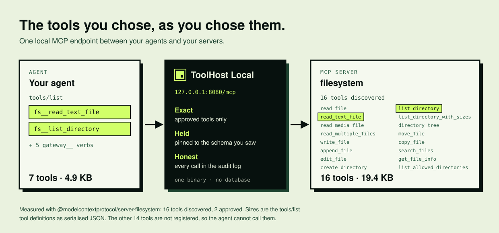
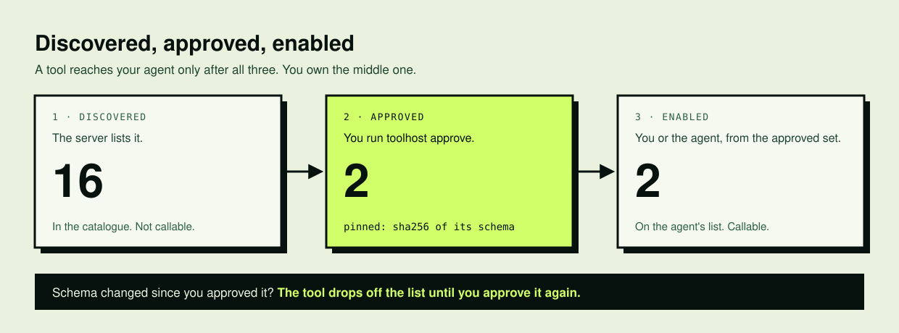

<p align="center">
  
</p>

<h1 align="center">ToolHost Local</h1>

<p align="center">
  <b>The tools you chose, as you chose them.</b><br>
  A local MCP gateway. Your agents connect to one endpoint and see only the tools you approved,<br>
  pinned to the schema you reviewed, with a record of every call.
</p>

<p align="center">
  <a href="https://github.com/gettoolhost/toolhost-local/actions/workflows/ci.yml"></a>
  <a href="https://github.com/gettoolhost/toolhost-local/releases"></a>
  
  <a href="LICENSE"></a>
</p>

<p align="center">
  <a href="#quickstart">Quickstart</a> ·
  <a href="#how-it-works">How it works</a> ·
  <a href="#works-with-your-clients">Clients</a> ·
  <a href="#reference">Docs</a>
</p>



## Two tools, not sixteen

Every MCP server you connect puts all of its tools in your agent's context, and within its reach. The official filesystem server lists 16, including `write_file`, `move_file` and `edit_file`. Connect a few servers and your agent picks from dozens of tools it was never meant to use, while each client config keeps its own copy of your server credentials.

ToolHost Local sits between your agents and your servers:

- Your agent sees one server, `local-gateway`, carrying only the tools you approved.
- A tool you didn't approve is never registered, so the agent can't call it.
- Server credentials stay in ToolHost Local. Your clients hold one local key.

| `server-filesystem` 2.4.0 | Tools in the agent's list | Tool definitions |
|---|---|---|
| Connected directly | 16 | 19.4 KB |
| Through ToolHost Local, 2 approved | 2, plus 5 `gateway__` verbs | 4.9 KB |

Reproduce it with [`scripts/measure-tools-list.sh`](scripts/measure-tools-list.sh); the recorded run is in [docs/MEASUREMENTS.md](docs/MEASUREMENTS.md).

One Go binary and a JSON file. No account, no database, no telemetry: it talks only to the servers you add and their sign-in endpoints.

## Quickstart

Install:

```bash
# macOS or Linux: verifies the release checksum, installs to ~/.local/bin (--dir to change)
curl -fsSL https://raw.githubusercontent.com/gettoolhost/toolhost-local/main/install.sh | bash

# or Homebrew
brew install gettoolhost/tap/toolhost

# or from source, with Go 1.26.2+
git clone https://github.com/gettoolhost/toolhost-local && cd toolhost-local
go build -o toolhost ./cmd/toolhost
```

Windows builds are on the [releases page](https://github.com/gettoolhost/toolhost-local/releases).

Add a server, approve two of its tools, and serve. The example server runs through `npx`, so it needs Node.js:

```console
$ toolhost init
wrote ~/.toolhost/toolhost.json

$ toolhost mcp add fs -- npx -y @modelcontextprotocol/server-filesystem ~/notes
added backend fs (stdio)

$ toolhost discover    # lists all 16 tools; none is callable yet

$ toolhost approve fs__read_text_file fs__list_directory
approved fs__list_directory
approved fs__read_text_file
live within ~2s if toolhost serve is running

$ toolhost serve
toolhost 0.0.4 serving 2 tools on http://127.0.0.1:8080/mcp (audit: toolhost_audit.jsonl, watching config)
```

Then point your agent at it, from a second terminal:

```bash
toolhost attach claude      # adds the local-gateway entry, with the local key, to Claude Code's config
toolhost doctor             # checks config, key, port, audit log and every server
```

`mcp add` takes the same `name -- command args` form as the `mcp add` command in most client CLIs. Already set servers up in a client? `toolhost mcp import claude` copies them across.

## What your agent sees

Your agent's tool list holds `fs__read_text_file`, `fs__list_directory` and the five `gateway__` verbs. Everything else gets an exact answer:

```text
call fs__list_directory          → [FILE] note.txt
call fs__write_file              → unknown tool "fs__write_file"
gateway__call fs__write_file     → "fs__write_file" is discovered but not approved
                                   — ask a human with gateway__request
gateway__request fs__write_file  → {"requested":["fs__write_file"],
                                    "note":"a human reviews petitions — nothing is granted yet"}
```

You answer from the terminal:

```console
$ toolhost requests
  tool   fs__write_file                   just now
        reason: save the summary

grant:  toolhost requests --accept <name>
deny:   toolhost requests --deny <name> --reason …
```

`--accept` approves the tool exactly as `toolhost approve` does, schema pinned. A denied request stays denied, and `gateway__discover` shows the agent your reason, so it doesn't ask again.

## How it works

**Exact.** One function, `core.Resolve`, builds the tool list from three sets: what your servers report, what you approved, and what is enabled. Only tools in all three are registered on the endpoint. Each registered tool's handler is wired straight to its server, so there is no lookup for a hidden tool to slip through. Two servers claiming the same tool name is an error, not a guess. A server that is down contributes no tools until it reconnects.

**Held.** `toolhost approve` records a SHA-256 of each tool's input and output schema. If a server later changes that schema, the tool leaves the list and `gateway__call` says why. It stays off until you approve the new schema. The pin covers the schemas only: a changed description or annotation doesn't hold the tool.

**Honest.** Every call that runs, every refused call (direct or through `gateway__call`), every failed key check, every enable, disable or request from the agent, and every reload is appended to a JSONL audit log. Records carry the tool, timing and error. They never carry arguments or results.

```console
$ toolhost audit -n 3
2026-11-27T10:17:05Z  tool_call       backend=fs  tool=fs__list_directory  6ms
2026-11-27T10:17:06Z  tool_forbidden  tool=fs__write_file
2026-11-27T10:17:06Z  govern          tool=request:fs__write_file
```

### Discovered, approved, enabled



| Step | Who decides | What it means |
|---|---|---|
| Discovered | the server | Listed in the catalogue. Not callable. |
| Approved | you, with `toolhost approve` | Pinned to the schema you saw. Eligible for the list. |
| Enabled | you or the agent, from the approved set | On the agent's list and callable as `server__tool`. |

With no `enabled` list in the config, every approved tool is enabled. `"enabled": []` enables none. The agent can never approve anything.

### The agent's five verbs

| Verb | What it does |
|---|---|
| `gateway__discover` | Searches the whole catalogue and shows each tool's state: enabled, approved, discovered or denied. |
| `gateway__enable` | Puts approved tools on the list. Subscribed clients get `tools/list_changed`. |
| `gateway__disable` | Takes tools off the list. They stay approved. |
| `gateway__call` | Calls an enabled tool by name, for clients that don't refresh their tool list. A refusal says why. |
| `gateway__request` | Asks you for an unapproved tool, or proposes a whole server: an address or a command, never credentials. |

Health and history are not tools: `toolhost status` (or `GET /status` with the key) and `toolhost audit`.

## Works with your clients

`toolhost attach <client>` merges one `local-gateway` entry, with the local key, into the client's own config file and leaves every other entry alone. Codex and Devin are attached through their own `mcp add` commands; Codex reads the key from `$TOOLHOST_TOKEN`. For Claude Code and Devin, attach also writes a `SKILL.md` that teaches the `gateway__` verbs into the client's user skills folder.

```text
claude  claude-desktop  cline  codex  cursor  devin  gemini  opencode  roo  vscode  windsurf  zed
```

- `toolhost attach` with no client lists which clients are installed and which are already attached.
- `--project` writes the client's project file in this folder, as a tokenless stdio spawn.
- `--stdio` has the client spawn `toolhost serve --stdio` instead of calling HTTP.
- `--dry-run` shows the merge; `--print` prints the entry for any other client.

Any client that speaks Streamable HTTP can use `http://127.0.0.1:8080/mcp` with `Authorization: Bearer <token>`.

## Servers and credentials

- **Transports:** stdio, Streamable HTTP and SSE upstreams. Another ToolHost Local can be an upstream too (`passthrough`).
- **Upstream auth, per server:** static headers, a bearer token, OAuth client credentials, or OAuth with PKCE through `toolhost mcp auth <name>`. OAuth grants live in the state directory, never in `toolhost.json`.
- **Credentials stay on their origin:** headers and tokens go only to the server's own scheme, host and port. A redirect to another origin is refused.
- **Secrets by reference:** `env:NAME` stays literal in the config and resolves when the server connects. An unset or empty variable stops the connection.
- **Least environment:** a stdio server gets a baseline (`PATH`, `HOME`, `SHELL`, `TERM`, `USER`, `LOGNAME`, `LANG`, `LC_ALL`, temp dirs, `XDG_CONFIG_HOME`, `XDG_CACHE_HOME`, and their Windows counterparts) plus only the variables you name in `env` or `env_allowlist`. `env_inherit: true` passes everything through.
- **Live config:** edits to `toolhost.json`, from the CLI, the agent or your editor, apply in about two seconds without a restart. A dead server reconnects with backoff, from 2 seconds up to 5 minutes.

## Security defaults

- Listens on `127.0.0.1:8080`.
- One bearer key, compared in constant time. A wrong key gets `401` and an `auth_failed` record.
- A request from a web page on another site (an `Origin` that isn't local) gets `403` before the key is checked. So does a `Host` header that isn't local on a loopback connection, which stops DNS rebinding from a browser tab.
- Config, audit log and request queue are written `0600` in a `0700` directory under `~/.toolhost`. Nothing is written into a project folder unless you ask: `toolhost init --shared` writes `./.toolhost/`, and `attach --project` writes the client's project file.
- Upstream calls time out after 60 seconds by default (`call_timeout`, with a per-server override).
- Release checksums are signed with cosign (keyless) and carry build provenance attestations.
- No telemetry. If you search the dependencies you'll find `check-proxy-existence.com` in the MCP Go SDK: it builds a request for that URL only to ask Go's proxy settings whether a proxy applies, and never sends it (`oauthex/oauth2.go`, `proxyConfigured`).

Please report vulnerabilities as described in [SECURITY.md](SECURITY.md).

## Run it as a service

```bash
toolhost install     # a launchd (macOS) or systemd --user (Linux) service; no root
toolhost status      # backends, tool counts and pending requests
```

## Not in ToolHost Local

One gateway, one key, one machine. ToolHost Local doesn't have users or teams, a key per client, per-client tool sets, rate limits, a web console, or prompts before each call.

## ToolHost, hosted

ToolHost Local is the open-source edition of ToolHost. The hosted edition:

- connects remote MCP servers over HTTPS;
- gives each client its own key and its own exact tool set;
- holds changed tools for your review;
- asks before each call to a destructive tool;
- shows activity in plain words.

Early access is by invitation from the waitlist.

## Reference

| Guide | Covers |
|---|---|
| [Configuration](docs/CONFIGURATION.md) | Every `toolhost.json` field, and where config and state live. |
| [CLI](docs/CLI.md) | Every command and flag. |
| [Approvals and requests](docs/GOVERNANCE.md) | The three steps, the five verbs, requests and the audit log. |
| [Transports](docs/TRANSPORTS.md) | Stateless and stateful modes, stdio, upstreams, chaining gateways. |
| [Authentication](docs/AUTHENTICATION.md) | The local key, upstream auth, `env:` references. |
| [Operations](docs/OPERATIONS.md) | The service, reloads, status, troubleshooting. |
| [Architecture](docs/ARCHITECTURE.md) | Ports and adapters, the resolver, a call from end to end. |

## Contributing

Issues and pull requests are welcome. See [CONTRIBUTING.md](CONTRIBUTING.md). Every change passes:

```bash
go vet ./... && gofmt -l . && go test ./... -count=1
```

## Licence

MIT. See [LICENSE](LICENSE).
